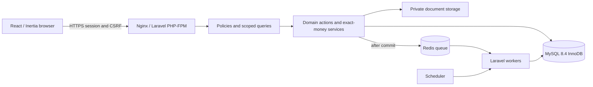

# Architecture proposal

[Index](README.md) · [Stack ADR](ADRS/0001-stack.md) · [Model](DATA_MODEL.md) · [Access](RBAC_MATRIX.md)

## Agreed constraints and proposed topology

S1–S3 require a modular Laravel monolith, official React/TypeScript/Inertia starter, MySQL 8.4 InnoDB and Redis. One deployment owns business rules; no independent Node API, Next.js or microservices. Installed foundation package versions are verified in [execution evidence](FOUNDATION_STATUS.md); [discovery](DISCOVERY.md) retains the initial environment baseline. The remainder of this document describes the full planned architecture, beyond the implemented foundation.



MySQL is authoritative. Redis loss must not erase posted financial facts. Rebuild caches from MySQL; jobs are retryable and idempotent. Use durable outbox events for critical follow-up when delivery must survive a crash between commit and dispatch; routine dashboard caches do not require that mechanism. Do not add messaging-provider integration in MVP.

## Proposed module and file structure

These are future paths, not existing files. Follow the selected starter's actual conventions rather than forcing a second framework.

```text
app/Domain/
  Inventory/Actions/{CreatePlot,ReservePlot,ReleaseReservation}
  CRM/Actions/{CreateCustomer,AssignAgent}
  Sales/Actions/{SubmitBooking,ApproveTerms,AllotPlot}
  Sales/Services/{ContractSnapshotter,ScheduleGenerator}
  Collections/Actions/{PostReceipt,AllocateReceipt,ReverseReceipt}
  Finance/Actions/{PostExpense,ApprovePayout,PostOwnerSettlement}
  Commissions/Actions/{AccrueCommission,ApproveCommission,PayCommission}
  Operations/{Queries,Actions}/
  Shared/{Money,BusinessClock,Idempotency}/
app/{Models,Policies,Http/Controllers,Http/Requests,Jobs}/
resources/js/{pages,components,layouts,types}/
routes/web.php
database/{migrations,factories,seeders}/
tests/{Unit,Feature,Integration,Browser}/
docs/
```

Controllers authenticate, validate via Form Requests, authorize and invoke actions. Actions own transactions and business transitions; models express relationships; query objects centralize scoped reports. Shared abstractions are limited to proven duplication. Domain events carry identifiers and approved rule versions, not sensitive documents. Avoid generic event sourcing or a custom module loader.

## Transaction contract

1. Authorize object and society/branch membership; validate normalized exact inputs.
2. Begin MySQL transaction and claim scoped idempotency key. A repeated key with different canonical payload fails; identical completed request returns original result after authorization.
3. Lock records in a documented order: plot before its reservation/allotment; financial commands use contract, receipts sorted by ID, installments sorted by ID, then account/sequence rows. Review mixed commands for a single consistent order before coding.
4. Re-read eligible state under lock; enforce policy version, balances and DB constraints.
5. Persist all effects, stable reference number, audit and durable result together. Roll back all on failure. Use bounded deadlock retries with the same key; return a retryable conflict after exhaustion.
6. Commit before PDF generation, notifications or external calls. Jobs have unique event identities and tolerate replay. Never hold DB locks during file scanning/network work.

Do not trust application-only sums against concurrent allocations. Lock the common receipt and installment parent rows for every writer before recomputing totals. Generated uniqueness protects allotments even if a writer bypasses UI logic. Reservation/allotment cross-table exclusion requires the common plot lock and an authoritative occupancy design in [model](DATA_MODEL.md).

## Money, time and historical records

Propose DECIMAL(18,2), decimal-string serialization and decimal arithmetic. Browser previews do not post authoritative values; server recomputes against approved snapshots. Persist business dates as DATE, event instants as UTC timestamps, and render using Asia/Karachi. Backdating and period controls need D08. Inject a business clock for boundary tests; never use prototype's fixed date. Keep rule/template versions and immutable contract snapshots; changes create amendments with effective dates.

## Security and privacy implementation

Session auth and CSRF via official starter; throttle login and sensitive mutations, rotate sessions after authentication, require HTTPS and secure cookies. D15 determines provisioning/MFA. Policies and scoped queries protect list, detail, mutation, search, export and downloads. Explicit writable fields prevent mass assignment of scope, roles, approval or posting status. Revalidate job scope/actor eligibility and protect queued exports. No raw identity data in client-wide props or logs.

Store uploads privately with opaque names, MIME/content/size allowlists, quarantine/scanning proposal and authorized short-lived downloads. Keep metadata separate from storage keys; redact identity values in audit diffs. Manage encryption keys and backup recovery together; retention/erasure decisions D12 must account for immutable finance and legal holds. Avoid assuming a particular legal retention period.

## Deployment, observability and recovery proposal

Separate development, test, staging and production; production uses Nginx/PHP-FPM, supervised queue workers and one controlled scheduler. Prefer private MySQL/Redis networking, TLS for remote MySQL, least-privilege application DB account and a distinct migration identity. Secrets enter through environment/secret manager; never source control. Private storage may be S3-compatible; choose hosting after D14.

CI builds immutable assets and tests migrations against MySQL 8.4. Deployment runbook: verify backups, review SQL/locking impact, apply backward-compatible schema changes, deploy assets/code, restart workers, run readiness/smoke checks. Avoid destructive rollback of posted finance; prefer forward correction. Large imports/index changes require rehearsal and explicit operational plan.

Daily encrypted DB and private-document backups are required by S1/S3. Propose binlog point-in-time recovery if D14 requires tighter RPO; retention, destination and RTO require approval. Back up keys separately and test restoration to an isolated environment, verifying attachments and financial control totals. A volume is not a backup. Monitor failed jobs, stale scheduler heartbeat, DB contention/deadlocks, disk growth, backup age, restore evidence and reconciliation discrepancies. Correlation IDs and safe event IDs replace PII in logs. Staging uses synthetic/redacted data.

## Quality strategy

See concrete test gates in [roadmap](ROADMAP.md). Unit tests cover deterministic decimal/date services under approved rules. Feature tests cover request validation/policies; real MySQL integration tests cover locks, constraints, races and posting; browser tests cover critical staff flows and keyboard/mobile behavior. SQLite cannot certify financial or concurrency correctness. Performance budgets follow D14 rather than invented targets.
