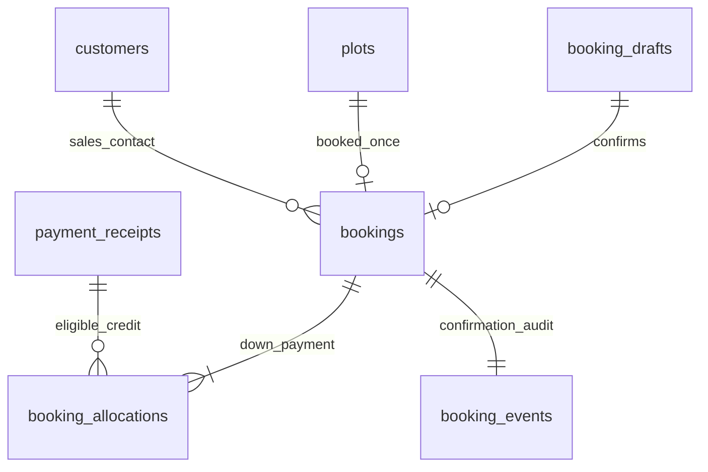
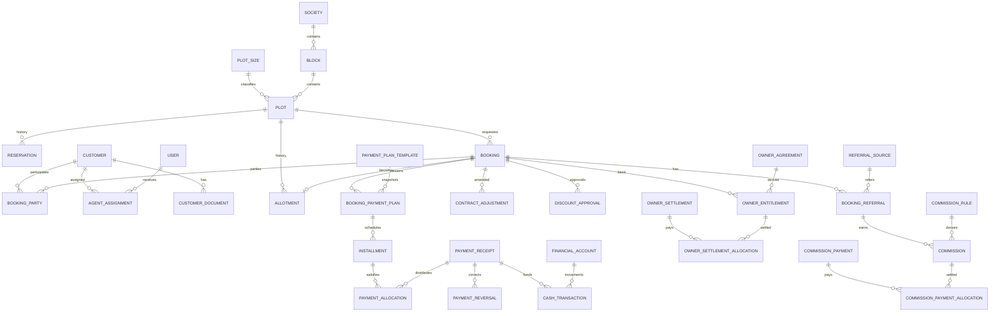

# Draft data model and integrity design

Installment increment (2026-11-05): `installment_batches` retains receipt/booking/actor, exact amount, date, policy snapshot, ledger revision and replay hash/key. `installment_allocations` stores positive original-schedule sequence claims, tied by composite FK to the same booking/receipt as the batch. Shared receipt usage combines these rows with `booking_allocations`; immutable agreed schedules remain in booking snapshots. See [ledger integrity and verification](INSTALLMENT_LEDGER_STATUS.md).

Implemented booking increment (2026-11-04): see [final booking status](FINAL_BOOKING_STATUS.md). `bookings` uniquely references the source proposal and plot, retains exact net/down-payment values, confirmed Karachi date/actor, public contract snapshot, separately encrypted purchaser identity snapshot and actor-scoped replay command. `booking_allocations` contains positive exact receipt-credit claims with a unique booking/receipt pair; available credit is rechecked under current receipt locks. `booking_events` retains the atomic confirmation attestation. Existing receipt recognition tables and these booking tables supersede the preparation-only boundaries in older sections below. Cancellation/transfer/reallocation tables remain future work.

Implemented finance preparation (2026-11-04): `financial_accounts` contains immutable code/type, editable label/active flag and optimistic version; `financial_account_events` retains setup history. `receipt_drafts` contains exact DECIMAL(18,2) reported amount, Karachi reported date, method, customer/account/optional matching draft references, encrypted external reference/notes, account/policy snapshots and version. `receipt_draft_events` retains amount/context/changed field names without private note/reference values. Unique actor/creation UUIDs and parent/revision keys, restrictive FKs and MySQL amount/type/version checks apply. These tables do not constitute recognized payments, opening balances or account movements. See [collection preparation status](COLLECTION_PREPARATION_STATUS.md).

Implemented terms subset (2026-11-04): `draft_terms` retains one latest proposed calculation per draft; `draft_term_events` retains unique draft/revision snapshots with actor/time. Exact money remains decimal strings in these JSON preparation artifacts. Snapshots include source draft version, explicitly selected inputs, full booking/installment policy versions/values, admin discount authority and derived schedule rows. These are not posted receivables or receipts. See [terms implementation](TERMS_STATUS.md).

Implemented purchaser subset (2026-11-04): `draft_purchasers` references draft/customer with `DECIMAL(7,4)` shares and unique draft/customer. Positive ≤100 shares are DB-checked; the locked domain action validates an exact 100% aggregate. `booking_drafts.purchasers_version` and `draft_purchaser_events` provide independent atomic before/after ID/share history. These are proposed parties, not registered ownership or final contract snapshots. See [purchaser implementation](PURCHASERS_STATUS.md).

Current implemented addition: `business_policies` and `business_policy_events` retain exact decimal-string setup values and section versions/history; no financial events are posted. Customer CNIC/address are encrypted and hidden from normal JSON. `customer_documents` holds private generated paths, kind/MIME/size/actor/time, with restrictive FKs and no delete/replace route. See [accepted operating rules and identity implementation](OPERATING_RULES_STATUS.md). Final contractual purchaser snapshots and transfers below remain future schema.

Implemented non-binding sales subset (2026-11-03): `booking_drafts` references a customer contact, plot and creator; stores exact proposed price, stable catalogue snapshot, notes, integer version and unique creator/creation key/hash. `booking_draft_events` has a restrictive draft FK, actor, unique draft/version, exact quote/snapshot values and note-change flag. Neither table grants occupancy or represents a legal contract, purchaser entitlement or receivable. Customer reassignment controls current access. See [sales implementation](SALES_DRAFT_STATUS.md); final lifecycle/financial ERD below remains proposed.

[Index](README.md) · [Decisions](FINANCIAL_DECISIONS.md) · [Architecture](ARCHITECTURE.md)

Status: full ERD remains a **TECHNICAL PROPOSAL**. The initial inventory catalogue subset is implemented following D01; D02/D03 and financial policies still gate sales/lifecycle migrations. Do not make every society key nullable or introduce SaaS tenants as a shortcut.

Implemented inventory subset: one `societies` profile slot constrained to ID 1; `blocks`, `plot_sizes`, `plots`, and append-only application `inventory_events`. Plots have block/size references and optional exact catalogue price, with no operational status column yet. Actor references are foreign-key protected. Inventory event subjects use action-controlled type/ID plus before/after snapshots, with no deletion endpoint for referenced catalogue records. See [scope ADR](ADRS/0002-single-society.md) and [inventory evidence](INVENTORY_STATUS.md).

Implemented owner-attribution extension (2026-11-07): `plot_owners` stores at most two named principal profiles. Each profile may link to one distinct admin/super-admin user through a unique foreign key; `plots.plot_owner_id` supplies nullable migration-safe attribution. New/edited plots require attribution once owner profiles exist. Confirmed bookings retain an owner ID/name snapshot. This relation is inventory attribution only and does not create owner entitlement, percentage, settlement or payout records. See [role and ownership status](ROLE_OWNERSHIP_LOCALIZATION_STATUS.md).

Implemented purchaser transfers (2026-11-09): `booking_transfers` appends a pending/approved/rejected ownership-change event to an immutable confirmed booking. It snapshots outgoing and incoming parties, encrypted private identity details, supporting-document IDs, remaining scheduled principal, actors and the Karachi effective date. `booking_transfer_parties` normalizes incoming customer/share references, whose exact four-decimal sum is transactionally validated as 100%. The latest approved event supplies active legal parties; original booking parties and every earlier transfer remain historical. See [transfer status](PURCHASER_TRANSFER_STATUS.md).

Implemented manual occupancy (2026-11-02): `plot_holds` retains reservation/block history with active/released states, actor/release metadata and required purpose. A stored generated `active_plot_id` is `plot_id` only for active rows, otherwise NULL; its unique index enforces exclusivity across both kinds. CHECKs enforce kind/state and complete release metadata. `inventory_commands` uniquely binds actor+UUID to a payload hash and hold result. No separate mutable availability flag or customer placeholder exists. Plot row locking serializes creation/release and catalogue edits; lifecycle actions do not acquire the catalogue society lock. Allotments do not exist yet: their future migration must extend this common occupancy authority, not introduce a second independently writable active table. See [hold evidence](HOLD_STATUS.md).

## Draft ERD

Implemented CRM subset (2026-11-03): `customers` stores name, optional phone/email, current assigned staff, creator and hidden creation key/hash. `customer_activities` records event/actor/time, changed field names and assignment IDs without copying raw contacts. `follow_ups` stores a customer-linked note, operator-selected business due date and optional completion actor/time. All referenced users/customers are FK protected. No identity document, contract, joint-party, payment or customer balance column is introduced. See [CRM implementation](CRM_UI_STATUS.md).

Cardinalities express historical records, not simultaneous active rights. Booking parties do not imply approved joint ownership. Generic audit, attachment, permissions and membership relationships are omitted for legibility, not from implementation.

## Entity catalog and migration order

All business rows use stable PKs, FKs, UTC timestamps and actor references as appropriate; posted events include effective business date, reason, source and rule version. Proposed IDs are bigint internally; public identifiers must still be authorized. Money DECIMAL(18,2), percentage precision separately documented; no float columns.

| Stage | Entities / important fields | Constraints and design notes |
|---|---|---|
| Foundation | users, roles, permissions, role_assignments; audit_events; idempotency_requests | Unique ability names; role/user join uniqueness; idempotency unique scope+operation+key, payload hash and result ID; actor permission changes audited |
| Inventory | societies; blocks(society_id,code); plot_sizes(label,marla); plots(block_id,size_id,number,status); price_schedules(plot_id,effective_from,amount); plot_status_history | Unique society+block code, block+normalized plot number; positive size; indexed scope/status/size; overlapping effective pricing rejected under lock |
| CRM | customers(name,contacts,protected_identity); customer_documents; agent_assignments(customer_id,user_id,from,to); document_attachments | Identity uniqueness and scope D12; private storage; assignment history; indexes on agent/customer/current interval |
| Sales | reservations(plot_id,customer_id,expires_at,state); bookings(plot_id,state,contract_ref,accepted_price,discount,net,rule_version); booking_parties; allotments(plot_id,booking_id,state) | Scope and party shares D01/D02; active uniqueness below; historical contracts restricted from deletion |
| Terms | payment_plan_templates(version,rules); booking_payment_plans(booking_id,version,snapshot); installment_schedules(plan_id,sequence,due_date,amount); rebates; discount_approvals; contract_adjustments | Unique plan+sequence; template immutable version; accepted snapshots retained; approval references exact requested terms hash; schedules cannot regenerate over posted allocations |
| Collections | payment_receipts(ref,payer,account_id,date,method,amount,state); payment_allocations(receipt_id,installment_id,amount); payment_reversals(original_id,amount,reason) | Unique reference in approved series; positive amounts; FKs plus locked aggregate checks; unique reversal command identity; no cascading posted deletion |
| Office finance | financial_accounts(type,currency); cash_transactions(account_id,direction,amount,date,typed_source); expenses; payouts; payout_approvals | Immutable posted movements; typed source FK/link tables preferred over unchecked polymorphic references; unique source event prevents duplicate movement |
| Owner | owner_agreements(version,basis,trigger,scope); owner_entitlements(agreement_version,booking_id,source_event,amount); owner_settlements; owner_settlement_allocations | D10 defines basis/trigger; unique agreement+source event; allocation totals protected by locks; payouts reference account movement |
| Referrals | referral_sources; booking_referrals; commission_rules(version,basis,trigger); commissions(state,amount,source_event); commission_payments; commission_payment_allocations | Rule snapshot and recipient; unique rule+referral+source event; prohibit repeated accrual; D11 defines clawbacks |
| Operations | reminders(subject_id,assignee,due_date,state); activity_logs; export_runs; import_batches/import_rows if D13 requires | Scoped notes, retryable export/import identities; activity feed is not a substitute for financial audit |

Branches/memberships are added only after D01. Ownership transfers, share constraints and succession structures wait for D02. Refund, clearing, approval and charge tables may be required by D06–D09; agree those workflows before final migrations. Optional GL/journals and messaging delivery tables are deferred.

## Exclusive allocation and reservation safety

Propose a generated nullable column on allotments, conceptually `CASE WHEN state IN (<approved active states>) THEN plot_id ELSE NULL END`, with UNIQUE(active_plot_id). Inactive rows yield NULL so history coexists. A UNIQUE(plot_id,state) does not enforce the invariant across different active states. Exact generated-column syntax and allowed states must be verified on MySQL 8.4, with state constraints and real migration tests before use.

Also lock the common plot row before creating, releasing or converting any reservation/allotment, and validate both tables under that lock. Allotment uniqueness alone cannot stop a reservation conflicting with an allotment. Proposal for stronger cross-type exclusion: one authoritative plot_occupancies table with one active slot per plot, typed reservation/allotment links and atomic conversion, paired with the allotment constraint. Choose this or a formally justified equivalent at D03; do not keep independent writable occupancy flags as authorities. Expiry time cannot be safely encoded as a clock-dependent unique expression; release uses an atomic checked transition, not passage of time alone.

## Cross-row financial invariants

Foreign keys/checks enforce valid references and positive amounts; receipt and installment aggregate limits require transactions locking common parent rows. Same-booking and same-scope allocation validation is mandatory, preferably composite FKs where practical. Booking-derived financial rows cannot point across societies/accounts. Sequence/reference allocation uses a transactional series row, never MAX+1. Idempotency records and money effects commit together; repeat keys with changed payload are conflicts. An audit failure must roll back the posting.

Use RESTRICT for financial and contract parent deletion; deactivate master records referenced by history. Cascades are limited to genuinely disposable non-posted children and reviewed individually. Protect posted data in actions and database privileges; soft-delete is not a finance correction mechanism. Reversals retain original links; balances are queries/projections with reconciliation, never freely editable columns.

## Index, migration and query review

Index FKs and common composite filters: scoped plots(status,block,size), assignments(agent,current range), installments(booking,due_date), receipts(scope,business_date,state), movements(account,business_date,id), audit(subject,time). Refine column order with EXPLAIN on representative D14 data. Historical as-of reports require effective/reversal dates, not current status alone. Review utf8mb4 collation effects on normalized plot/reference uniqueness. Test strict mode, decimal overflow, foreign keys, generated indexes and rollback on MySQL. Production migrations favor additive expand/contract changes; destructive changes require separate review and restored-copy rehearsal.
