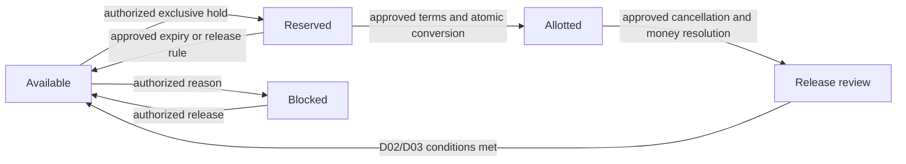
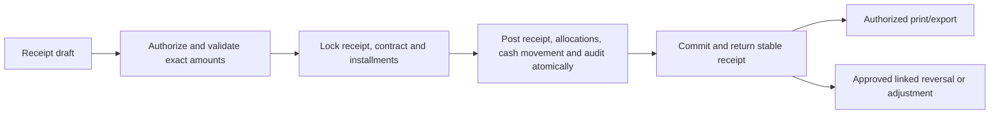

# Product requirements

[Index and source keys](README.md) · [Decisions](FINANCIAL_DECISIONS.md) · [RBAC](RBAC_MATRIX.md) · [Roadmap](ROADMAP.md)

## Agreed product boundary

EstateFlow is an internal Pakistani housing society office ERP. Initial currency is PKR; operational dates use Asia/Karachi, with UTC instants for events. English is initial UI language; design permits Urdu localization later. Use a Laravel modular monolith with the official React/TypeScript/Inertia starter, MySQL 8.4 InnoDB and Redis. Exact package compatibility remains a prerequisite. Sources: S1, S2, S3, U1.

MVP spans inventory, scoped CRM, reservations/bookings/allotments, approved terms and plans, collections, operational finance, owner settlements, commissions, manual follow-up, reports and calculator. Financial modules can be planned now but cannot post under unspecified policies. Formal double-entry GL, trial balance, P&L, statutory balance sheet, automated messaging and SaaS tenancy are outside MVP absent explicit approval. D01 is resolved: one configurable society/office per installation, reusable by another society in its own installation. Shared multi-society and branch isolation are outside the current scope. Joint purchasing and transfer/resale (D02) remain unresolved. See [ADR 0002](ADRS/0002-single-society.md).

## Stories, traceability and acceptance

Every story additionally requires server authorization, scoped queries, validation, accessible error states and relevant audit evidence. IDs persist across implementation tickets.

| ID / source | User story | Observable acceptance criteria | Dependencies |
|---|---|---|---|
| PR01 / S1,S2 | As main admin, delegate explicit abilities | Unauthorized direct requests fail; changing a role is audited; delegated admin cannot grant beyond authority | RBAC proposal review; D01 |
| PR02 / S1,S2,S4 | As operator, configure blocks, sizes and plots | User-defined positive sizes supported; duplicate plot number within same block rejected; filters and schematic block view agree with table; state history retained | D01,D03 |
| PR03 / S2,S4 | As agent, manage assigned customer contacts and documents | Foreign customer IDs, search results, statements and attachment downloads are denied; assignment change takes effect on next request | D01,D02,D12 |
| PR04 / S1,S2 | As agent, reserve and request booking | Two simultaneous requests cannot win the same exclusive plot; denied/expired attempts leave no active hold; user sees conflict and can refresh | D03; real MySQL tests |
| PR05 / S2 | As approver, confirm contract terms | Unapproved discount cannot alter payable value; accepted price, plan and applicable rules are immutable snapshots; catalog edits leave contract unchanged | D02,D04,D05 |
| PR06 / S2 | As accountant, generate receivable schedule | Same approved inputs yield same exact entries; entries total approved scheduled charges; boundary dates and residual handling match signed examples | D05,D06 |
| PR07 / S1–S3 | As accountant, collect and allocate funds | Receipt stores payer, actor, method, date, account, reference and amount; retry returns same result; parallel allocations never exceed receipt availability or installment due | D06,D07,D08 |
| PR08 / S2,S3 | As authorized approver, correct posted money | Original remains visible; reversal links original and reason; duplicate reversal is idempotent; statements and cashbook reconcile afterwards | D07,D08 |
| PR09 / S2,S4 | As accountant, record expenses and payouts | Account, party, reason, evidence and approval retained; no posted deletion; opening plus signed movements reconciles closing | D08,D09 |
| PR10 / S1,S2 | As finance approver, settle owner obligations | Only approved agreement version produces entitlements; settlement cannot silently change obligation; reversal/refund scenarios reconcile | D09,D10 |
| PR11 / S1,S2 | As finance approver, manage referrals | Calculated, earned, payable, paid distinguishable; trigger is evidenced; duplicate accrual/payout prevented; cancellation treatment follows approved rule | D09,D11 |
| PR12 / S2,S4 | As agent, record follow-up notes | Authorized customer only; due date and assignee filterable; no SMS/WhatsApp sent | D12; manual reminders only |
| PR13 / S2,S4 | As manager, inspect operational reports | Inventory, bookings, collections, receivables, overdue, payouts and commissions use defined as-of filters and scoped data; exports match drilldown totals | D01,D06,D08,D13 |
| PR14 / S2,S4 | As agent, preview a payment plan | Formula and rounding policy shown; estimate clearly marked; calculation saves no financial transaction and cannot approve discount | D04,D05,D11 |
| PR15 / S1,S2 | As operator, import/export authorized records | Dry-run errors identify rows; duplicate source identifiers do not duplicate records; template/version and actor recorded; export prevents spreadsheet formula injection | D12,D13 |

## Proposed workflows — state names require D03 approval

The user approved manual staff-attributed holds on 2026-11-02: agents/admins confirm immediately, no expiry or approval queue, authorized admins alone release/block. An existing hold/block must be released before replacement. Internal purpose is required; no placeholder customer is created. This implemented subset is described in [hold status](HOLD_STATUS.md). Contract/allotment states in the broader proposal below still await separate policy decisions.

Booking proposal: draft → submitted → approved/rejected; approved terms plus successful exclusive allocation create an allotment. Plot occupancy, booking approval and payment completion are separate dimensions. No automatic mapping of prototype `booked` or `sold` to legal ownership. D02/D03 must define terminology, documents and allowed transitions.

Failure at any transaction stage rolls back all authoritative records. Network retries use the same scoped key. Refund is a separate approved outflow, not deletion of a receipt.

## UX and report contract

Persistent sidebar; responsive agent lookup; global search scoped on the server; paginated/sortable tables; status labels with text; keyboard navigation; focus and validation summaries; drawer/modal confirmations; unsaved-edit warning; empty/loading/retry states; history; print-friendly receipt/statement. Never populate dashboard financial KPIs with invented values.

Proposed metric definitions, subject to D06/D08/D13: inventory counts by state at as-of instant; booked value from approved effective contracts net of approved adjustments; collections from eligible posted receipt movements net of linked reversals; outstanding from effective charges less valid allocations; overdue from unpaid due entries before the chosen business cutoff. Unallocated money is shown separately. Payouts are account outflows; owner/commission payables derive from approved entitlement events. Cashbook totals are operational movements, never a balance sheet. Historical as-of queries must exclude later events even if a current status changed.

## Prototype reconciliation

S4 localStorage is not production persistence; its role selector is not authentication or authorization. Floating point, whole-rupee display and live recalculation from mutable plan templates are illustrative. The 65% owner share is unapproved. `booked/sold` needs formal lifecycle reconciliation. Simulated oldest-first allocation, date rollover, 25% down payment and seeded commission rates are not approved policies. Cashbook is not a formal balance sheet. CNIC/email required fields, broad accountant visibility and demo reset are not production requirements. Demo payment references and purpose strings cannot substitute for typed foreign keys and approvals.

## Security, privacy and quality acceptance

Least privilege and object-level authorization apply to every route, export, search, queued job and document. Sessions use CSRF protection, secure cookies, login throttling and session invalidation on access changes. No public self-registration assumed for this internal ERP; invitation/access provisioning needs review. Mask identity details; private allowlisted/size-limited uploads, malware scanning/quarantine proposal, encrypted transport and storage, audited downloads and retention rules D12. Exclude secrets and raw CNIC/document contents from logs. Backup access follows production access restrictions.

No measured performance SLO or capacity is approved: D14 must supply expected users, plot counts, daily receipt volume, availability and recovery targets. Before release, agree representative datasets and measurable response budgets. Financial correctness and cross-user isolation are release blockers regardless of speed.

## Assumptions requiring validation

Internal staff browser access and manual payment entry are planning assumptions; no bank gateway integration is promised. Legacy migration, mandatory print formats, tax/fee requirements, operational opening balances and document retention require decisions. Acceptance scenarios must use synthetic DEMO identities only.
