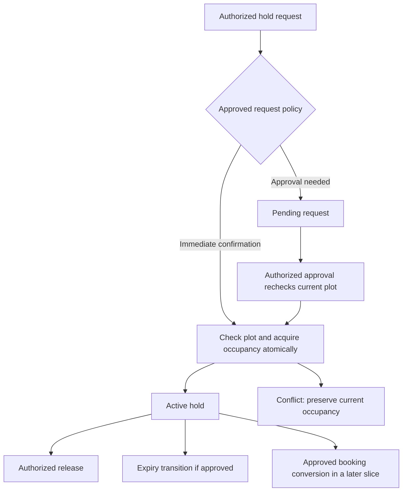

# Reservation and occupancy execution plan

[Index](README.md) · [Requirements](PRODUCT_REQUIREMENTS.md) · [Data model](DATA_MODEL.md) · [Decisions](FINANCIAL_DECISIONS.md) · [Roadmap](ROADMAP.md)

Prepared 2026-10-31; updated 2026-11-02. This baseline describes candidate approaches, followed by the selected manual-hold implementation in [hold status](HOLD_STATUS.md). The user selected manual release and immediate confirmation without approval, delegated beneficiary design and restricted changes to authorized admins. Internal staff-attributed holds now avoid the unresolved customer identity dependency. S4's booked/sold badges still do not define contract transitions. The proposal sections below remain design context where not explicitly superseded.

## Decisions needed to start

| Choice | Options to approve | Implementation consequence |
|---|---|---|
| D03-A release | Manual release; timed expiry with an explicit duration/unit; approval-dependent expiry | Determines whether a scheduler is required, when a deadline begins and whether `expires_at` is required. No duration is selected. |
| D03-B authority | Authorized agent confirms immediately; admin approves a request | Approval adds a pending state and approve/reject actions. Decide whether pending requests occupy inventory and whether competing requests are allowed. |
| D03-C hold beneficiary | Customer required; internal staff hold before CRM | Customer references depend on D12 identity/privacy rules and CRM delivery. Internal holds must not invent placeholder customers. |
| D03-D changes | Who may release, extend, cancel or block? May the holder act on their own request? | Determines explicit abilities, ownership checks and separation of duties; role names alone grant nothing. |
| D03-E cutoff | At deadline, what happens to an in-flight approval/conversion? Is extension allowed after deadline? | Requires signed before/equal/after boundary examples and one authoritative server-clock decision. |
| D03-F blocking | May a plot be blocked while held? What reason and clearance are needed? | Determines whether blocking rejects, replaces, or first releases an existing hold. No destructive override is assumed. |
| D03-G conversion | What precisely constitutes allotted, and how do release/cancellation work after allotment? | Allotment depends on booking/terms approval under D02/D04. A hold must not silently create a contract or financial entitlement. |

Selected scope: manual holds, no deadline/extension or approval queue; staff beneficiary and purpose; admin-only release/block; no blocking over an existing hold; no allotment conversion. D03-G and future customer binding remain deferred. D15 still governs broader production delegation.

## Proposed workflow

Pending occupancy, expiry, blocked plots and exact lifecycle names remain policy choices. The diagram shows candidate paths; it does not approve them. Catalogue edits must not change the holder or release an occupied plot. A price edit is not acceptance of sale terms.

## Proposed persistence and transactions

Use one authoritative active occupancy slot per plot, following the cross-type exclusion proposal in the [data model](DATA_MODEL.md). Proposed `plot_occupancies` has `plot_id` as primary key, an occupancy kind and typed references, with valid combinations enforced by foreign keys/checks. Historical reservation and allotment rows remain separate. Final columns and checks wait for approved states; do not install a placeholder status schema now.

Every transition locks the common plot row, then its current slot and relevant reservation/booking rows in consistent order. Recheck the actor's current abilities and allowed transition inside the transaction. Atomically update history, slot, result record and audit; an audit failure rolls back all effects. Return a conflict with refreshed plot context when another operation won. Do not delete or overwrite the other requester's record.

For multi-plot operations, lock plot IDs in ascending order. Reservation actions must not acquire the current catalogue's society mutex after taking plot locks unless all participating actions follow a documented compatible order. Review catalogue edit locking before introducing lifecycle actions; do not rely on the existing catalogue mutex to prove operational exclusivity.

Proposed idempotency identity is unique `(actor_id, operation, key)` with a normalized request hash and result reference. Same key and same payload returns the original outcome; changed payload conflicts. Identity and effects commit together. Keys are not authorization: a replay still authenticates and checks access to the result. Terminal failures need an explicitly documented retry contract rather than caching arbitrary exceptions.

If timed expiry is selected, store a UTC instant and approved rule version; display it in Asia/Karachi. A worker finds candidate IDs, then locks and rechecks each individually. A candidate read is not permission to expire a renewed or converted hold. The passage of time alone cannot remove an occupancy slot or satisfy a unique constraint. Define on-request overdue handling and exact cutoff with D03-E, so a delayed worker does not create two incompatible interpretations of availability. Redis/scheduler verification remains a gate for any worker-dependent release.

## Proposed implementation files and dependencies

| Area | Proposed additions | Depends on |
|---|---|---|
| Schema | Additive reservation, occupancy and idempotency migrations; reviewed constraints/indexes | Approved D03 states/beneficiary; CRM relation if selected |
| Domain | `app/Domain/Inventory/Actions/RequestHold.php`, `ReleaseHold.php`; optional `ApproveHold.php`, `ExtendHold.php`, `ExpireHold.php` | Approved transition table and authority |
| HTTP | Dedicated validated requests, reservation controller and explicit abilities | D03 authority; production D15 |
| UI | Plot hold panel, current-state/conflict feedback, history, optional approval queue | Confirmed lifecycle language; no financial or customer PII in unrelated props |
| Worker | Expiry command/job, scheduling, health/lag monitoring | Timed expiry approval and verified worker infrastructure |
| Tests | MySQL independent-process transition races, policy tests, browser flows | Signed policy fixtures and committed isolated setup |

These paths are planned files, not existing components. Do not scaffold all actions if the selected workflow does not require them. No messaging, payment posting, commission, owner entitlement or SaaS tenancy enters this slice.

## Acceptance and verification gate

| Scenario | Required evidence |
|---|---|
| Two holds on one plot | Independent MySQL sessions start at a barrier; exactly one active slot and one successful reservation; loser receives a conflict |
| Two plots | Independent holds succeed; no accidental installation-wide lifecycle lock serializes every plot |
| Hold versus block/conversion | Approved precedence holds under both controlled transaction schedules; never two active rights |
| Duplicate command | Same key produces one effect and one audit; changed payload conflicts; rolled-back command leaves no partial occupancy |
| Repeated release | Stable documented response; no second release event or slot removed from a later holder |
| Expiry versus extension/conversion | Before/equal/after approved cutoff fixtures; only one permitted winner; stale job cannot expire replacement occupancy |
| Revoked authority / tampering | Current server permission denies action; posted actor, owner, state and timestamps cannot grant authority |
| History failure | Injected audit failure rolls back reservation, slot and idempotency result together |
| Browser | Current holder/state displayed only to authorized viewers; validation preserves input; duplicate click/retry and stale-view conflict handled; mobile and keyboard checked |
| Migration | Fresh and populated-copy migration on MySQL 8.4; FKs/CHECKs/uniqueness verified; rollback only on disposable data |

These are **planned tests**, not executed results. Existing duplicate catalogue creation tests do not prove these races. Record real commands/outcomes after implementation, including Redis skips and unexecuted remote CI.

## Execution checklist

- [ ] Capture D03-A through G with approver, examples and effective date; reconcile formal lifecycle with prototype labels.
- [ ] Confirm beneficiary dependency and produce the exact transition/ability table.
- [ ] Review occupancy constraints, idempotency retention, clock/cutoff and lock order; approve the technical design.
- [ ] Implement only the selected hold workflow behind explicit abilities; keep allotment conversion gated if sales policy is unresolved.
- [ ] Execute MySQL race/idempotency/audit-failure tests and the browser scenarios above.
- [ ] Verify worker/scheduler delivery and alerting if required; document recovery for overdue jobs.
- [ ] Update implementation evidence and review M2's exit gate; do not mark all M2 complete while allotment safety remains unproven.

The manual-hold scope is now authorized; follow [actual implementation evidence](HOLD_STATUS.md) for its completed checks. Allotment/booking transitions and timed expiry remain outside the selected slice.
